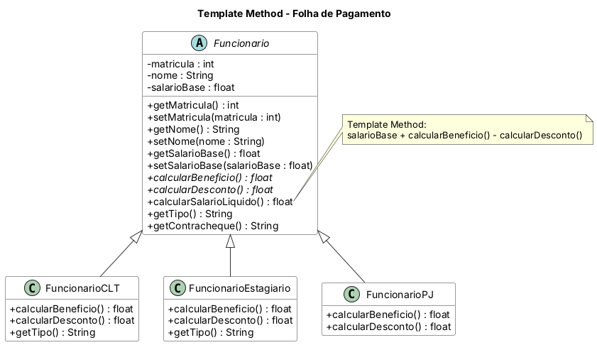

# Padrão Template Method

Aplicação de **folha de pagamento**. A classe abstrata `Funcionario` define o algoritmo `calcularSalarioLiquido()` (salário base + benefício − desconto) e o `getContracheque()`; as subclasses `FuncionarioCLT`, `FuncionarioEstagiario` e `FuncionarioPJ` implementam apenas os passos variáveis (benefício e desconto) e o gancho `getTipo()`.

## Diagrama de classes



O fonte do diagrama (PlantUML) está em `diagrama/diagrama-classes.puml`.

## Estrutura

- `src/main/java` — código-fonte
- `src/test/java` — casos de teste (JUnit 5)
- `diagrama/` — diagrama de classes

## Como executar os testes

```bash
mvn test
```

Ou abra o projeto no IntelliJ e rode a pasta `src/test/java`.

Java 11 · Maven · JUnit 5
